 

 

 

  

  

 

<table>
  <tr>
    <td align="right"><code>LANGUAGES</code></td>
    <td></td>
  </tr>
  <tr>
    <td align="right"><code>FRONTEND</code></td>
    <td></td>
  </tr>
  <tr>
    <td align="right"><code>BACKEND + DATA</code></td>
    <td></td>
  </tr>
  <tr>
    <td align="right"><code>TOOLS</code></td>
    <td></td>
  </tr>
  <tr>
    <td align="right"><code>DESIGN</code></td>
    <td>
      
      
    </td>
  </tr>
</table>

 

 

<table>
  <tr>
    <td>
      
    </td>
    <td>
      
    </td>
  </tr>
  <tr>
    <td>
      
    </td>
    <td>
      
    </td>
  </tr>
</table>

More on my <a href="https://github.com/MethZ0?tab=repositories">repositories page</a>

 

 

 

I split my time between engineering and visual storytelling. When I'm not shipping features, I'm animating, designing environments and illustrating.

 

 

 

  
  

  

 

  

 

  <picture>
    <source media="(prefers-color-scheme: dark)" srcset="https://raw.githubusercontent.com/MethZ0/MethZ0/output/github-contribution-grid-snake-dark.svg">
    <source media="(prefers-color-scheme: light)" srcset="https://raw.githubusercontent.com/MethZ0/MethZ0/output/github-contribution-grid-snake.svg">
    
  </picture>

 

 

 

*Open to collaborations, internships and exciting projects. Let's build something together.*

 

