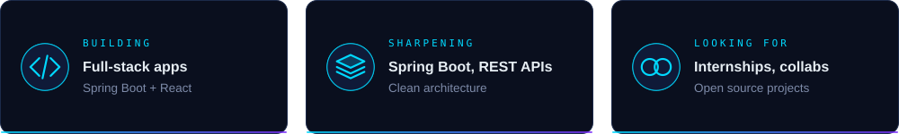

<div align="center">



<br/>

<a href="https://themethush.dev/"></a>
&nbsp;
<a href="https://github.com/MethZ0?tab=repositories"></a>
&nbsp;
<a href="mailto:methushanjula01@gmail.com"></a>

<br/><br/>

**SOFTWARE ENGINEERING&nbsp; / &nbsp;AI & AUTOMATION&nbsp; / &nbsp;VISUAL STORYTELLING**

*Building useful things. Making them feel right.*

<br/>


&nbsp;


</div>

<br/>

---



<table>
<tr>
<td width="62%" valign="top">

### Engineer by logic. Creative by default.

I’m **Methush Anjula** — also known as **METHZ0**. I’m a software engineering undergraduate interested in building applications that solve real problems, exploring how AI can make software more useful, and shaping the details that make digital experiences feel considered.

My work moves between **application development, automation, AI-driven ideas, and visual design**. I enjoy the whole process: understanding a problem, figuring out the architecture, making the interface feel right, and polishing the details most people might miss.

</td>
<td width="38%" valign="top">

```text
┌─ METHZ0 ─────────────────┐
│                           │
│  mode    : BUILD          │
│  focus   : SOFTWARE + AI  │
│  medium  : CODE / VISUALS │
│  status  : ITERATING      │
│                           │
│  curiosity > comfort      │
└───────────────────────────┘
```

</td>
</tr>
</table>

<details>
<summary><b>↳ Current operating principles</b></summary>

- Solve the actual problem before reaching for a new framework.
- Prefer clear, maintainable systems over clever complexity.
- Treat usability and visual quality as part of engineering, not a finishing touch.
- Stay curious, test assumptions, and keep shipping.

</details>

<br/>



<table>
<tr>
<td width="33%" valign="top">

**01 / ENGINEER**

Building full-stack applications, APIs, and data-backed workflows.

</td>
<td width="33%" valign="top">

**02 / EXPLORE**

Experimenting with AI, intelligent applications, and practical automation.

</td>
<td width="34%" valign="top">

**03 / CREATE**

Working across interface design, animation, and visual storytelling.

</td>
</tr>
</table>

<br/>



<div align="center">

<sub>TOOLS I USE TO TURN IDEAS INTO WORKING SOFTWARE</sub>

<br/><br/>

**LANGUAGES**


<br/><br/>

**FRONTEND**


<br/><br/>

**BACKEND & DATA**


<br/><br/>

**WORKFLOW & CREATIVE TOOLS**


<br/><br/>

<sub>Also exploring: Tailwind CSS · FastAPI · Power Platform · workflow automation</sub>

</div>

<br/>

---



<div align="center">

<sub>SELECTED REPOSITORIES&nbsp; / &nbsp;OPEN THE SOURCE TO EXPLORE</sub>

</div>

<table>
<tr>
<td width="50%" valign="top">

<a href="https://github.com/MethZ0/mern-stack-gym-management-system"></a>

**GYM MANAGEMENT SYSTEM**

A MERN-stack project focused on managing gym-related workflows.

<a href="https://github.com/MethZ0/mern-stack-gym-management-system">↗ View repository</a>

</td>
<td width="50%" valign="top">

<a href="https://github.com/MethZ0/mern-stack-full-ecommerce-site-practice"></a>

**MERN E-COMMERCE**

A full-stack e-commerce practice project built around the MERN ecosystem.

<a href="https://github.com/MethZ0/mern-stack-full-ecommerce-site-practice">↗ View repository</a>

</td>
</tr>
<tr>
<td width="50%" valign="top">

<a href="https://github.com/MethZ0/my-personal-portfolio-react-framer-motion"></a>

**PERSONAL PORTFOLIO**

A React portfolio exploring motion and personal presentation.

<a href="https://github.com/MethZ0/my-personal-portfolio-react-framer-motion">↗ View repository</a>

</td>
<td width="50%" valign="top">

<a href="https://github.com/MethZ0/react-js-project-code-00"></a>

**REACT JS LAB**

A space for React experiments and hands-on frontend practice.

<a href="https://github.com/MethZ0/react-js-project-code-00">↗ View repository</a>

</td>
</tr>
</table>

<div align="center">

<a href="https://github.com/MethZ0?tab=repositories"></a>

</div>

<br/>



<table>
<tr>
<td width="42%" valign="top">



</td>
<td width="58%" valign="top">

### The other side of the screen.

I’m interested in more than what software does — I care about how it communicates. Animation, digital art, environment design, and visual storytelling give me another way to explore ideas.

That creative practice feeds back into engineering: stronger composition, better visual hierarchy, and more intentional experiences.

<br/>

<a href="https://www.artstation.com/methush"></a>
&nbsp;
<a href="https://www.instagram.com/methush_/"></a>

</td>
</tr>
</table>

<br/>



<div align="center">

<sub>ACTIVITY LOG&nbsp; / &nbsp;A SNAPSHOT OF THE BUILD PROCESS</sub>

<br/><br/>


&nbsp;


<br/><br/>


<br/><br/>


<br/><br/>

<picture>
  <source media="(prefers-color-scheme: dark)" srcset="https://raw.githubusercontent.com/MethZ0/MethZ0/output/github-contribution-grid-snake-dark.svg">
  <source media="(prefers-color-scheme: light)" srcset="https://raw.githubusercontent.com/MethZ0/MethZ0/output/github-contribution-grid-snake.svg">
  
</picture>

</div>

<br/>

---



<div align="center">

### HAVE A GOOD PROBLEM TO SOLVE?

I'm open to collaborations, interesting engineering challenges, and projects where technology and creativity meet.

<br/>

<a href="https://themethush.dev/"></a>
&nbsp;
<a href="https://www.linkedin.com/in/methush/"></a>
&nbsp;
<a href="mailto:methushanjula01@gmail.com"></a>
&nbsp;
<a href="https://linktr.ee/methush"></a>

<br/><br/>

<sub><code>DESIGN WITH INTENT. BUILD WITH CURIOSITY. SHIP WITH CARE.</code></sub>

<br/><br/>


<sub>Made of code, creative detours, and an occasional unnecessary refactor.</sub>

</div>
